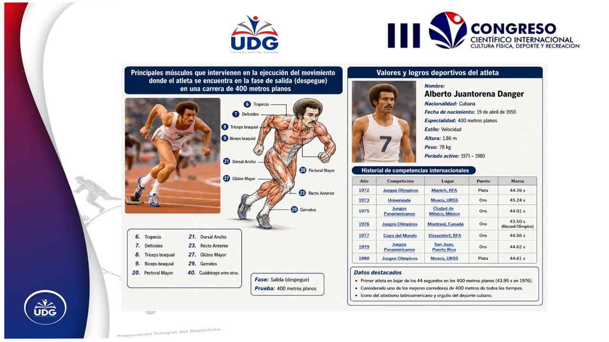
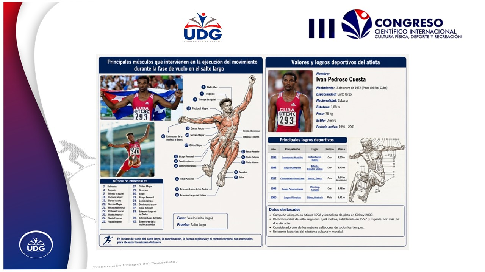
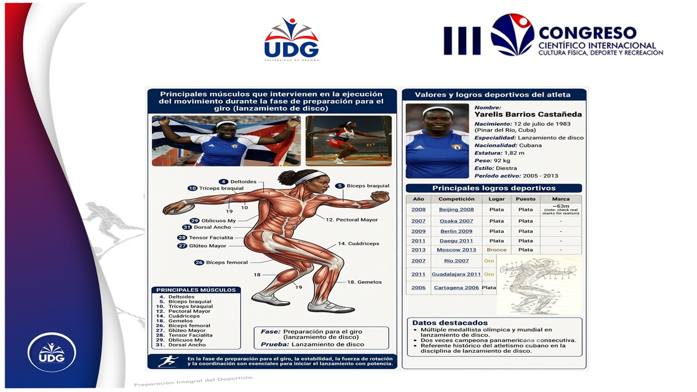

<!DOCTYPE html>
<html lang="es">
<head>
  <meta charset="UTF-8">
  <meta name="viewport" content="width=device-width, initial-scale=1.0">
  <title>Póster Digital Biocinemático - Morfología Funcional y Atletismo</title>
  
  <link rel="stylesheet" href="https://cdnjs.cloudflare.com/ajax/libs/font-awesome/6.5.1/css/all.min.css">
  <link href="https://fonts.googleapis.com/css2?family=Montserrat:wght@600;700;800&family=Inter:wght@400;500;600;700&display=swap" rel="stylesheet">
  

  

  

</head>
<body class="antialiased selection:bg-blue-900 selection:text-white">

  <!-- ENCABEZADO DEL PÓSTER DIGITAL -->
  <header class="cuban-gradient text-white shadow-xl border-b-4 border-red-600">
    

      

        

          

            

              <i class="fa-solid fa-university mr-1.5"></i>Universidad de Camagüey • Cuba
              <i class="fa-solid fa-person-running mr-1.5"></i>Morfología Funcional y Atletismo
              <i class="fa-solid fa-award mr-1.5"></i>III Congreso Científico Internacional CFDR
            

            <!-- FECHA ALINEADA ARRIBA A LA DERECHA -->
            
              <i class="fa-regular fa-calendar-days text-amber-300"></i> Diciembre 2026
            
          

          <h1 class="text-2xl sm:text-3xl lg:text-4xl font-extrabold tracking-tight leading-tight">
            Participación Muscular Biocinemática en Atletismo para la Enseñanza de la Morfología Funcional
          </h1>
          

            Recurso didáctico interdisciplinario para el análisis estructura–función en patrones básicos del movimiento humano
          

        

        <!-- TARJETA DE AUTORES -->
        

          
Autores de la Investigación

          

            
MSc. Julio Miguel Gallardo Fines

            
Profesor Auxiliar • ORCID: 0009-0004-2931-473X

          

          

            
MSc. Ricardo Femenias Horta

            
Profesor Auxiliar • ORCID: 0009-0009-1321-4255

          

        

      

    

  </header>

  <!-- CONTENIDO PRINCIPAL DEL PÓSTER -->
  <main class="max-w-7xl mx-auto px-4 sm:px-6 lg:px-8 py-8 space-y-8">

    <!-- BLOQUE SUPERIOR: FUNDAMENTACIÓN BIOCINEMÁTICA Y OBJETIVO -->
    <section class="grid grid-cols-1 md:grid-cols-3 gap-6">
      

        

          

            <i class="fa-solid fa-bullseye"></i>
          

          <h2 class="text-lg font-bold text-slate-900 mb-2">Propósito Didáctico</h2>
          

            Caracterizar la participación biocinemática muscular en tres eventos del atletismo básico (carreras, saltos y lanzamientos) articulando la anatomía funcional con el gesto deportivo real mediante referentes del deporte cubano.
          

        

        

          Enfoque: Teórico–Práctico
          1.er Año Cultura Física
        

      

      

        

          

            <i class="fa-solid fa-compass-drafting"></i>
          

          <h2 class="text-lg font-bold text-slate-900 mb-2">Dimensiones Biocinemáticas</h2>
          <ul class="text-sm text-slate-600 space-y-1.5">
            <li><i class="fa-solid fa-check text-red-600 mr-2"></i><strong>Planos:</strong> Sagital, frontal y transversal.</li>
            <li><i class="fa-solid fa-check text-red-600 mr-2"></i><strong>Ejes:</strong> Perlateral, anteroposterior y longitudinal.</li>
            <li><i class="fa-solid fa-check text-red-600 mr-2"></i><strong>Acciones:</strong> Flexión, extensión, rotación, abducción y aducción.</li>
            <li><i class="fa-solid fa-check text-red-600 mr-2"></i><strong>Regímenes musculares:</strong> Concéntrico, excéntrico e isométrico.</li>
          </ul>
        

        

          Análisis sin considerar fuerzas externas (Donskoi & Zatsiorski, 1988)
        

      

      

        

          

            <i class="fa-solid fa-layer-group"></i>
          

          <h2 class="text-lg font-bold text-slate-900 mb-2">Patrones Motores Básicos</h2>
          

            El atletismo reproduce movimientos naturales del ser humano que permiten observar directamente la coordinación neuromuscular:
          

          

            1. Correr
            2. Saltar
            3. Lanzar
          

        

        

          Morfología Funcional + Atletismo
          <a href="#autoevaluacion" class="underline hover:text-emerald-950">Ir a Autoevaluación ↓</a>
        

      

    </section>

    <!-- SELECTOR INTERACTIVO DE LOS 3 PANELES DEL PÓSTER -->
    <section class="bg-white rounded-2xl shadow-md border border-slate-200 overflow-hidden">
      

        

          Explorador Anatómico-Deportivo Interactivo
          <h2 class="text-xl font-bold text-white">Selecciona el Evento Atlético para Analizar el Panel</h2>
        

        

          <i class="fa-solid fa-hand-pointer text-amber-400"></i>
          Haz clic en cada pestaña o vista completa
        

      

      <!-- MENÚ COLAPSABLE PARA MÓVILES Y PESTAÑAS DE NAVEGACIÓN PARA ESCRITORIO -->
      

        <button onclick="toggleMobileMenu()" id="mobile-menu-toggle" aria-expanded="false" class="w-full min-h-[44px] bg-[#0c2340] text-white font-display text-sm font-bold px-4 py-3 rounded-lg flex items-center justify-between shadow-sm cursor-pointer">
          
            <i class="fa-solid fa-bars text-amber-400"></i>
            1. Carreras (400 m)
          
          <i id="mobile-menu-chevron" class="fa-solid fa-chevron-down text-xs transition-transform"></i>
        </button>
      

      

        <button onclick="selectEvent('carrera')" id="btn-carrera" class="tab-active w-full min-h-[48px] py-4 px-4 flex items-center justify-center gap-2 transition cursor-pointer">
          <i class="fa-solid fa-person-running text-lg"></i>
          1. Carreras (400 m)
        </button>
        <button onclick="selectEvent('salto')" id="btn-salto" class="tab-inactive w-full min-h-[48px] py-4 px-4 flex items-center justify-center gap-2 transition cursor-pointer">
          <i class="fa-solid fa-up-right-and-down-left-from-center text-lg"></i>
          2. Saltos (Longitud)
        </button>
        <button onclick="selectEvent('lanzamiento')" id="btn-lanzamiento" class="tab-inactive w-full min-h-[48px] py-4 px-4 flex items-center justify-center gap-2 transition cursor-pointer">
          <i class="fa-solid fa-compact-disc text-lg"></i>
          3. Lanzamientos (Disco)
        </button>
        <button onclick="selectEvent('todos')" id="btn-todos" class="tab-inactive w-full min-h-[48px] py-4 px-4 flex items-center justify-center gap-2 transition cursor-pointer">
          <i class="fa-solid fa-table-columns text-lg"></i>
          Vista Póster Completo
        </button>
      

      <!-- CONTENEDOR DE PANELES DINÁMICOS -->
      

        <!-- ========================================================= -->
        <!-- PANEL 1: CARRERAS (400 METROS PLANOS - ALBERTO JUANTORENA) -->
        <!-- ========================================================= -->
        <article id="panel-carrera" class="space-y-6">
          

            

              Panel 1 • Patrón Cíclico Fundamental (Diapositiva 4)
              <h3 class="text-xl sm:text-2xl font-extrabold mt-1">
                Principales músculos que intervienen en la ejecución del movimiento en la fase de salida (despegue) en 400 metros planos
              </h3>
            

            

              
Prueba: 400 metros planos

              
Fase: Salida (despegue posterior y apoyo anterior)

            

          

          <!-- LÁMINA GRÁFICA PROTAGÓNICA DEL PÓSTER -->
          

            

              <i class="fa-solid fa-image text-amber-400 mr-2"></i>Figura 1. Caracterización biocinemática y muscular durante las fases de despegue posterior y apoyo anterior en 400 m planos (Alberto Juantorena Danger)
              <button onclick="openLightbox('Diapositiva4.JPG', 'Figura 1. Fase de salida (despegue) en 400 metros planos — Alberto Juantorena Danger')" class="bg-red-600 hover:bg-red-700 text-white font-bold px-3 py-1 rounded-md transition flex items-center gap-1.5 cursor-pointer">
                <i class="fa-solid fa-magnifying-glass-plus"></i>
                Ampliar Lámina (Pantalla Completa)
              </button>
            

            

              
            

          

          

            

              

                

                  <i class="fa-solid fa-person-running mr-1.5"></i>Análisis Biocinemático del Gesto Deportivo
                  Plano Sagital • Eje Perlateral
                

                

                  Las carreras atléticas constituyen patrones cíclicos fundamentales caracterizados por la alternancia de fases de apoyo y vuelo. Durante la salida, se exige una elevada sincronización intermuscular para generar fuerza propulsiva y controlar la inclinación del tronco.
                

                

                  

                    
Tren Inferior (Propulsión)

                    
Extensión explosiva de cadera y rodilla: <strong>Glúteo Mayor (27)</strong>, <strong>Cuádriceps (23, 40)</strong> y <strong>Gemelos (29)</strong>.

                  

                  

                    
Tronco y Hombro

                    
Control postural: <strong>Trapecio (6)</strong>, <strong>Deltoides (7)</strong> y <strong>Dorsal Ancho (21)</strong>.

                  

                  

                    
Miembro Superior

                    
Flexo-extensión alterna: <strong>Bíceps (9)</strong> y <strong>Tríceps braquial (8)</strong>.

                  

                

              

              <!-- LISTADO INTERACTIVO DE MÚSCULOS -->
              

                

                  <h4 class="text-sm font-extrabold uppercase tracking-wider text-blue-950 flex items-center gap-2">
                    <i class="fa-solid fa-list-ol text-red-600"></i>
                    Principales músculos en fase de salida (400 m planos):
                  </h4>
                  <i class="fa-solid fa-circle-info text-blue-800 mr-1"></i>Haz clic en un músculo
                

                

                  <button onclick="showMuscleInfo('6. Trapecio', 'Estabiliza y eleva la cintura escapular durante el braceo vigoroso en la salida baja.', 'Tronco')" class="muscle-pill text-left bg-slate-50 hover:bg-blue-50 border border-slate-200 px-3 py-2 rounded-lg flex items-center gap-2 cursor-pointer">
                    6
                    Trapecio
                  </button>
                  <button onclick="showMuscleInfo('7. Deltoides', 'Ejecuta la flexión y extensión de la articulación escapulohumeral en el braceo.', 'Hombro')" class="muscle-pill text-left bg-slate-50 hover:bg-blue-50 border border-slate-200 px-3 py-2 rounded-lg flex items-center gap-2 cursor-pointer">
                    7
                    Deltoides
                  </button>
                  <button onclick="showMuscleInfo('8. Tríceps braquial', 'Extiende la articulación del codo durante el impulso posterior del brazo.', 'Miembro Superior')" class="muscle-pill text-left bg-slate-50 hover:bg-blue-50 border border-slate-200 px-3 py-2 rounded-lg flex items-center gap-2 cursor-pointer">
                    8
                    Tríceps braquial
                  </button>
                  <button onclick="showMuscleInfo('9. Bíceps braquial', 'Mantiene la flexión dinámica del codo en el recobro anterior del brazo.', 'Miembro Superior')" class="muscle-pill text-left bg-slate-50 hover:bg-blue-50 border border-slate-200 px-3 py-2 rounded-lg flex items-center gap-2 cursor-pointer">
                    9
                    Bíceps braquial
                  </button>
                  <button onclick="showMuscleInfo('20. Pectoral Mayor', 'Asiste en la flexión horizontal y aducción del brazo delantero.', 'Tronco Anterior')" class="muscle-pill text-left bg-slate-50 hover:bg-blue-50 border border-slate-200 px-3 py-2 rounded-lg flex items-center gap-2 cursor-pointer">
                    20
                    Pectoral Mayor
                  </button>
                  <button onclick="showMuscleInfo('21. Dorsal Ancho', 'Extiende el hombro hacia atrás y estabiliza el tronco.', 'Tronco Posterior')" class="muscle-pill text-left bg-slate-50 hover:bg-blue-50 border border-slate-200 px-3 py-2 rounded-lg flex items-center gap-2 cursor-pointer">
                    21
                    Dorsal Ancho
                  </button>
                  <button onclick="showMuscleInfo('23. Recto Anterior', 'Flexiona la cadera en el recobro y extiende la rodilla en el apoyo.', 'Muslo')" class="muscle-pill text-left bg-slate-50 hover:bg-red-50 border border-slate-200 px-3 py-2 rounded-lg flex items-center gap-2 cursor-pointer">
                    23
                    Recto Anterior
                  </button>
                  <button onclick="showMuscleInfo('27. Glúteo Mayor', 'Principal extensor de la cadera; genera la mayor potencia propulsiva.', 'Cadera')" class="muscle-pill text-left bg-slate-50 hover:bg-red-50 border border-slate-200 px-3 py-2 rounded-lg flex items-center gap-2 cursor-pointer">
                    27
                    Glúteo Mayor
                  </button>
                  <button onclick="showMuscleInfo('29. Gemelos', 'Realiza la flexión plantar explosiva del tobillo en el despegue.', 'Pierna')" class="muscle-pill text-left bg-slate-50 hover:bg-red-50 border border-slate-200 px-3 py-2 rounded-lg flex items-center gap-2 cursor-pointer">
                    29
                    Gemelos
                  </button>
                

                

                  

                    
                    
                  

                  

                

              

            

            <!-- ATLETA REFERENTE -->
            

              

                <i class="fa-solid fa-medal text-amber-400 mr-2"></i>Atleta Referente: Alberto Juantorena
                Cuba
              

              

                

                  

                    AJ
                  

                  

                    <h4 class="text-base font-extrabold text-slate-900">Alberto Juantorena Danger</h4>
                    
<strong>Especialidad:</strong> 400 y 800 metros planos

                    
<strong>Hito histórico:</strong> Único atleta en ganar el oro olímpico en 400m y 800m en la misma olimpiada (Montreal 1976).

                  

                

                

                  
<i class="fa-solid fa-star text-amber-500 mr-1"></i>Valor pedagógico:

                  
Demostración práctica de la amplitud de zancada y potencia glucolítica óptima para el estudio de la morfología funcional en estudiantes de Cultura Física.

                

              

            

          

        </article>

        <!-- ========================================================= -->
        <!-- PANEL 2: SALTOS (SALTO DE LONGITUD - IVÁN PEDROSO)        -->
        <!-- ========================================================= -->
        <article id="panel-salto" class="hidden space-y-6">
          

            

              Panel 2 • Patrón Acíclico Combinado (Diapositiva 5)
              <h3 class="text-xl sm:text-2xl font-extrabold mt-1">
                Principales músculos que intervienen en la ejecución del movimiento durante la fase de vuelo en el salto largo
              </h3>
            

            

              
Prueba: Salto de Longitud

              
Fase: Vuelo y preparación para la caída

            

          

          <!-- LÁMINA GRÁFICA PROTAGÓNICA DEL PÓSTER -->
          

            

              <i class="fa-solid fa-image text-amber-400 mr-2"></i>Figura 2. Caracterización biocinemática y muscular durante la fase de vuelo del salto de longitud (Iván Pedroso Cuesta)
              <button onclick="openLightbox('Diapositiva5.JPG', 'Figura 2. Fase de vuelo en el salto largo — Iván Pedroso Cuesta')" class="bg-red-600 hover:bg-red-700 text-white font-bold px-3 py-1 rounded-md transition flex items-center gap-1.5 cursor-pointer">
                <i class="fa-solid fa-magnifying-glass-plus"></i>
                Ampliar Lámina (Pantalla Completa)
              </button>
            

            

              
            

          

          

            

              

                

                  <i class="fa-solid fa-up-right-and-down-left-from-center mr-1.5"></i>Análisis Biocinemático de la Fase Aérea
                  Secuencia: Batida → Vuelo → Caída
                

                

                  En el salto de longitud, la velocidad horizontal se transforma en impulso vertical en la batida. Durante el vuelo, el control postural del tronco y los movimientos compensatorios de los miembros superiores evitan rotaciones indeseadas.
                

              

              <!-- LISTADO INTERACTIVO DE MÚSCULOS (SALTO) -->
              

                

                  <h4 class="text-sm font-extrabold uppercase tracking-wider text-blue-950 flex items-center gap-2">
                    <i class="fa-solid fa-list-ol text-red-600"></i>
                    Principales músculos en fase de vuelo (Salto Longitud):
                  </h4>
                

                

                  <button onclick="showMuscleInfo('3. Deltoides / Hombro', 'Estabiliza y proyecta los brazos en el aire para mantener el equilibrio dinámico.', 'Miembro Superior')" class="muscle-pill text-left bg-slate-50 hover:bg-blue-50 border border-slate-200 px-3 py-2 rounded-lg flex items-center gap-2 cursor-pointer">
                    3
                    Deltoides
                  </button>
                  <button onclick="showMuscleInfo('11. Abdominales / Recto del Abdomen', 'Flexiona el tronco y compacta el cuerpo para preparar la extensión final hacia el foso.', 'Tronco')" class="muscle-pill text-left bg-slate-50 hover:bg-blue-50 border border-slate-200 px-3 py-2 rounded-lg flex items-center gap-2 cursor-pointer">
                    11
                    Abdominales
                  </button>
                  <button onclick="showMuscleInfo('23. Cuádriceps (Recto Anterior)', 'Mantiene extendida la rodilla durante la preparación de la caída.', 'Tren Inferior')" class="muscle-pill text-left bg-slate-50 hover:bg-red-50 border border-slate-200 px-3 py-2 rounded-lg flex items-center gap-2 cursor-pointer">
                    23
                    Cuádriceps
                  </button>
                

                

                  

                    
                    
                  

                  

                

              

            

            <!-- ATLETA REFERENTE SALTO -->
            

              

                <i class="fa-solid fa-medal text-amber-400 mr-2"></i>Atleta Referente: Iván Pedroso
                Cuba
              

              

                

                  

                    IP
                  

                  

                    <h4 class="text-base font-extrabold text-slate-900">Iván Pedroso Cuesta</h4>
                    
<strong>Especialidad:</strong> Salto de Longitud

                    
<strong>Logros:</strong> Campeón Olímpico (Sídney 2000), 9 veces Campeón Mundial.

                  

                

                

                  
<i class="fa-solid fa-star text-amber-500 mr-1"></i>Valor pedagógico:

                  
Modelo cinemático óptimo para el estudio de cadenas cinéticas abiertas y cerradas en la biomecánica del salto.

                

              

            

          

        </article>

        <!-- ========================================================= -->
        <!-- PANEL 3: LANZAMIENTOS (LANZAMIENTO DE DISCO)              -->
        <!-- ========================================================= -->
        <article id="panel-lanzamiento" class="hidden space-y-6">
          

            

              Panel 3 • Patrón Acíclico de Rotación (Diapositiva 6)
              <h3 class="text-xl sm:text-2xl font-extrabold mt-1">
                Principales músculos que intervienen en la ejecución del movimiento durante el esfuerzo final en el lanzamiento de disco
              </h3>
            

            

              
Prueba: Lanzamiento de Disco

              
Fase: Esfuerzo final y descarga

            

          

          <!-- LÁMINA GRÁFICA PROTAGÓNICA DEL PÓSTER -->
          

            

              <i class="fa-solid fa-image text-amber-400 mr-2"></i>Figura 3. Caracterización biocinemática y muscular durante el esfuerzo final en el lanzamiento de disco
              <button onclick="openLightbox('Diapositiva6.JPG', 'Figura 3. Esfuerzo final en el lanzamiento de disco')" class="bg-red-600 hover:bg-red-700 text-white font-bold px-3 py-1 rounded-md transition flex items-center gap-1.5 cursor-pointer">
                <i class="fa-solid fa-magnifying-glass-plus"></i>
                Ampliar Lámina (Pantalla Completa)
              </button>
            

            

              
            

          

          

            

              

                

                  <i class="fa-solid fa-compact-disc mr-1.5"></i>Análisis Biocinemático de la Rotación
                  Plano Transversal • Eje Longitudinal
                

                

                  Los lanzamientos requieren la transferencia secuencial de fuerza desde los miembros inferiores, a través de la torsión y rotación del tronco, hasta la extremidad superior ejecutora (latigazo cinemático).
                

              

              <!-- LISTADO INTERACTIVO DE MÚSCULOS (LANZAMIENTO) -->
              

                

                  <h4 class="text-sm font-extrabold uppercase tracking-wider text-blue-950 flex items-center gap-2">
                    <i class="fa-solid fa-list-ol text-red-600"></i>
                    Principales músculos en esfuerzo final (Lanzamiento de Disco):
                  </h4>
                

                

                  <button onclick="showMuscleInfo('7. Deltoides', 'Ejecuta la abducción y rotación del brazo ejecutor durante la descarga.', 'Hombro')" class="muscle-pill text-left bg-slate-50 hover:bg-blue-50 border border-slate-200 px-3 py-2 rounded-lg flex items-center gap-2 cursor-pointer">
                    7
                    Deltoides
                  </button>
                  <button onclick="showMuscleInfo('20. Pectoral Mayor', 'Realiza la aducción y rotación interna del brazo en el momento culminante del lanzamiento.', 'Tronco Anterior')" class="muscle-pill text-left bg-slate-50 hover:bg-blue-50 border border-slate-200 px-3 py-2 rounded-lg flex items-center gap-2 cursor-pointer">
                    20
                    Pectoral Mayor
                  </button>
                  <button onclick="showMuscleInfo('27. Glúteo Mayor y Rotadores', 'Generan la rotación externa y potencia inicial desde el suelo en la plataforma del círculo.', 'Cadera')" class="muscle-pill text-left bg-slate-50 hover:bg-red-50 border border-slate-200 px-3 py-2 rounded-lg flex items-center gap-2 cursor-pointer">
                    27
                    Glúteo Mayor
                  </button>
                

                

                  

                    
                    
                  

                  

                

              

            

            <!-- ATLETA REFERENTE LANZAMIENTO -->
            

              

                <i class="fa-solid fa-medal text-amber-400 mr-2"></i>Escuela Cubana de Lanzamientos
                Cuba
              

              

                

                  
Tradición y Excelencia Metodológica

                  
La escuela cubana de lanzamientos ha destacado internacionalmente por la maestría técnica en la aplicación de la fuerza explosiva y la fluidez rotacional (ej. Maritza Martén, Denia Caballero, Yaime Pérez).

                

                

                  
<i class="fa-solid fa-star text-amber-500 mr-1"></i>Valor pedagógico:

                  
Estudio clave de la cadena cinética abierta distal para comprender la transmisión de energía angular.

                

              

            

          

        </article>

        <!-- ========================================================= -->
        <!-- VISTA COMPLETA (MUESTRA LOS 3 PANELES JUNTOS)            -->
        <!-- ========================================================= -->
        <article id="panel-todos" class="hidden space-y-12">
          

            <h3 class="text-xl font-bold text-amber-300">Modo Presentación: Vista Integral del Póster Científico</h3>
            
A continuación se muestran de forma consecutiva los tres paneles de análisis biocinemático e imagenes originales del trabajo.

          

          

            

              <h4 class="text-lg font-bold text-blue-900 mb-4">1. Patrón Cíclico: Carreras (400 m Planos)</h4>
              
            

            

              <h4 class="text-lg font-bold text-blue-900 mb-4">2. Patrón Acíclico: Saltos (Salto de Longitud)</h4>
              
            

            

              <h4 class="text-lg font-bold text-blue-900 mb-4">3. Patrón Rotacional: Lanzamientos (Lanzamiento de Disco)</h4>
              
            

          

        </article>

      

    </section>

    <!-- SECCIÓN DE AUTOEVALUACIÓN Y CONCLUSIONES -->
    <section id="autoevaluacion" class="grid grid-cols-1 md:grid-cols-2 gap-6">
      

        

          

            <i class="fa-solid fa-clipboard-question"></i>
          

          

            <h3 class="text-base font-bold text-slate-900">Autoevaluación Formativa</h3>
            
Comprueba tu dominio de la morfología funcional

          

        

        

          

            
1. ¿Qué músculo actúa como principal extensor de la cadera en el despegue de la carrera?

            

              <label class="flex items-center gap-2 cursor-pointer"><input type="radio" name="q1" value="a"> A) Bíceps braquial</label>
              <label class="flex items-center gap-2 cursor-pointer font-semibold text-emerald-800"><input type="radio" name="q1" value="b"> B) Glúteo mayor (Correcto)</label>
              <label class="flex items-center gap-2 cursor-pointer"><input type="radio" name="q1" value="c"> C) Dorsal ancho</label>
            

          

        

      

      

        

          

            <i class="fa-solid fa-graduation-cap"></i>
          

          

            <h3>Conclusiones Pedagógicas</h3>
            
Implicaciones para la docencia

          

        

        <ul class="text-xs text-slate-600 space-y-2">
          <li><i class="fa-solid fa-circle-check text-emerald-700 mr-2"></i>La articulación entre anatomía y biocinemática facilita la comprensión del gesto deportivo en estudiantes de Cultura Física.</li>
          <li><i class="fa-solid fa-circle-check text-emerald-700 mr-2"></i>El uso de referentes deportivos cubanos potencia la motivación y el sentido de pertenencia profesional.</li>
        </ul>
      

    </section>

  </main>

  <!-- PIE DE PÁGINA CON AVISO DE DERECHOS DE AUTOR DISCRETO Y ELEGANTE -->
  <footer class="max-w-7xl mx-auto px-4 sm:px-6 lg:px-8 py-8 mt-12 border-t border-slate-200 text-center text-xs text-slate-500 space-y-1">
    
III Congreso Científico Internacional Cultura Física, Deporte y Recreación (CFDR)

    
&copy; 2026 MSc. Julio Miguel Gallardo Fines &amp; MSc. Ricardo Femenias Horta. Todos los derechos reservados.

  </footer>

  <!-- MODAL LIGHTBOX PARA AMPLIAR LÁMINAS -->
  

    

      
      <button onclick="closeLightbox()" class="bg-white/20 hover:bg-white/40 text-white min-h-[44px] min-w-[44px] px-4 py-2.5 rounded-lg font-bold transition flex items-center gap-2 cursor-pointer">
        <i class="fa-solid fa-xmark text-lg"></i> Cerrar
      </button>
    

    

      
    

  

  <!-- SCRIPTS DE INTERACTIVIDAD -->
  

  

</body>
</html>
